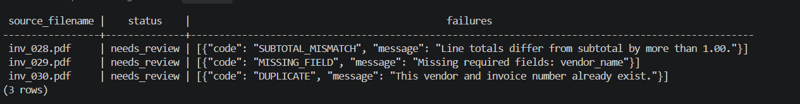

# doc-to-record-pipeline

Converts invoice PDFs into validated PostgreSQL records, flagging anything it is not confident about for human review instead of storing it as clean data.

## Results

Measured on 30 synthetic invoices across 5 layouts, three of which are deliberately malformed.

| Field | Accuracy |
| --- | ---: |
| vendor_name | 100% |
| invoice_number | 100% |
| invoice_date | 100% |
| due_date | 100% |
| total | 100% |
| line_items_count | 100% |
| line_items (every item exact) | 96.7% |

| System behaviour | Value |
| --- | ---: |
| Auto-approval rate | 90% (27/30) |
| Flagging precision | 100% (3/3) |
| Mean confidence | 0.743 |
| Mean latency | 4.6 s per document |
| Mean tokens | 1,238 per document |

All three deliberately broken documents were flagged, each by the check intended to catch it, with no false positives.

| Document | Fault | Check that fired |
| --- | --- | --- |
| INV-2026-028 | Line items do not sum to printed subtotal | `SUBTOTAL_MISMATCH` |
| INV-2026-029 | Vendor name absent | `MISSING_FIELD` |
| INV-2026-030 | Duplicate of INV-2026-001 | `DUPLICATE` |




## How it works

Seven stages, each a separate module:

1. **Ingest** — the PDF gets a UUID, a row in `documents` with status `received`, and is stored on disk under that UUID so the original is always recoverable.
2. **Text extraction** — `pdfplumber` reads the text layer; pages yielding almost no text fall back to OCR.
3. **LLM extraction** — one structured-output call returns a fixed JSON shape with a confidence score per field. No free-text parsing.
4. **Validation** — nine deterministic checks in plain Python: arithmetic, date sanity, required fields, duplicates.
5. **Routing** — no failures means `approved`; any failure means `needs_review` with the failure codes recorded.
6. **Persistence** — the document and its line items are written in a single transaction, with an audit row per stage.
7. **API** — FastAPI exposes submission, retrieval, the review queue, and manual approval.

### Validation checks

| Code | Rule |
| --- | --- |
| `SUBTOTAL_MISMATCH` | Line totals sum to subtotal, tolerance 1.00 |
| `TOTAL_MISMATCH` | Subtotal plus tax equals total, tolerance 1.00 |
| `LINE_MATH` | Quantity times unit price equals line total |
| `MISSING_FIELD` | Vendor, invoice number and total are present |
| `BAD_DATE` | Invoice date parses and is not in the future |
| `DATE_ORDER` | Due date is not before the invoice date |
| `NEGATIVE_VALUE` | No negative quantities or amounts |
| `LOW_CONFIDENCE` | Every populated field scores at or above 0.70 |
| `DUPLICATE` | This vendor and invoice number are not already stored |

## Running it

```bash
git clone https://github.com/sruthimundekkottil/doc-to-record-pipeline.git
cd doc-to-record-pipeline
cp .env.example .env          # then add your model API key and a Postgres password
docker compose up -d --wait
```

The API is then at `http://127.0.0.1:8000`, with interactive docs at `/docs`.

Submit a document:

```bash
curl -F "file=@data/invoices/inv_001.pdf;type=application/pdf" \
     http://127.0.0.1:8000/documents
```

### Database URLs

Two different values, depending on where the code runs:

- Inside the compose network (the API service): `postgresql://postgres:<password>@db:5432/invoices`
- From the host (running scripts directly): `postgresql://postgres:<password>@127.0.0.1:5433/invoices`

`db` is the compose service name and only resolves inside the Docker network.

### Regenerating fixtures and evaluating

```bash
python scripts/generate_invoices.py   # 30 PDFs plus ground-truth JSON
python -m scripts.eval                # reads stored records, makes no LLM calls
```

The schema is applied only when the database volume is created. After changing `sql/schema.sql`, run `docker compose down -v` before starting again.

## Design decisions

**Validation never calls the model.** Arithmetic and date checks are plain Python. Asking a language model to verify its own output adds cost and a second source of error for something that is deterministic. The model is used only for the part that needs language understanding.

**Money is `Decimal` in Python and `NUMERIC(12,2)` in PostgreSQL.** Floating point cannot represent values like 0.10 exactly, so totals drift by fractions of a unit and consistency checks begin failing on correct documents.

**Every extracted field is nullable.** A model required to produce a vendor name will invent one when the field is absent from the document. `None` is a legitimate answer, and the validation layer decides what to do about it. Line-item fields are the exception: an item without a description or amount is not an item.

**Three tables, not one.** An invoice has many line items, so they cannot share a row. More importantly, the record of what the *system did* — `processing_log` — is a different kind of fact from the record of what the *invoice says*, and keeping them apart means a document that failed halfway still has an audit trail showing where it stopped.

**Confidence routing uses the minimum field score, not the mean.** One badly-read field is what makes a record untrustworthy; averaging hides it behind several confident ones.

## What the evaluation found

Two things surfaced only when the full corpus ran, neither of which the unit tests caught.

**False positives on absent optional fields.** The first full run flagged two invoices with no tax line. The model returned no confidence entry for a field that legitimately did not exist, and the validator read that absence as a confidence of zero. An absent optional field is not an unreliable one. The check now skips fields whose extracted value is `None`; required fields remain covered by `MISSING_FIELD`.

**A transcription error the validation layer cannot catch.** The single line-item failure (INV-2026-022) was a misread digit: the model read "phase 22" as "phase 2" in both line items. Every arithmetic check passed, so the document auto-approved. Deterministic checks verify internal consistency, not fidelity to the source text. Catching this would need a different mechanism — for example, verifying that each extracted string actually appears in the extracted page text.

An earlier run reported 0% line-item accuracy. That turned out to be a fixture bug rather than an extraction failure: the generator rendered descriptions into the PDF without a separator that it kept in the ground-truth JSON, so the answer key did not match the document. The generator now derives both from the same string.

## Limitations

- **Synthetic data.** No public invoice corpus is both realistic and free of personal information, and generating the documents is what provides per-field ground truth. Five layouts is far short of real-world variety.
- **`field_confidence` is self-reported and uncalibrated.** Prompt-level rubrics produced a usable relative spread, but the model applies them loosely — an explicitly printed currency code still scored 0.90. Routing relies primarily on the deterministic checks; confidence is a secondary signal.
- **OCR is implemented but untested.** Tesseract was unavailable in the development environment, so the scanned-document path has not been exercised.
- **Processing is synchronous.** The API runs the full pipeline before responding, so throughput is bound by model latency. At volume this needs a queue: accept the document, return immediately, process in a worker.
- **One document type.** Extending to purchase orders or delivery notes means a new contract and a new rule set, not a new pipeline — but that has not been built.

## Tests

```bash
pytest -q
```

Coverage focuses on `validate.py`, which is pure functions with no I/O and the module where a bug corrupts data silently rather than raising. Also covered: transaction rollback, concurrent duplicate submission, and the evaluation comparisons.

## Stack

Python 3.11+, FastAPI, PostgreSQL 16 (psycopg 3, raw SQL), Pydantic v2, pdfplumber, reportlab, pytest, Docker Compose. Extraction runs against `gemini-3.5-flash-lite`.
